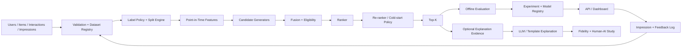

# RecomLab Architecture

## 1. Goal

RecomLab is a local-first, modular recommender platform. It intentionally separates **retrieval**, **ranking**, **re-ranking**, **evaluation**, and **human-facing explanation** so errors at one stage are not hidden by another.

## 2. High-Level Flow

## 3. Dataset Layer

Canonical entities:
- `User`
- `Item`
- `Interaction`
- `Impression`
- `FeedbackEvent`
- `DatasetManifest`

Raw data is immutable. Cleaning, labels, splits, and features are versioned derived artifacts.

## 4. Retrieval Layer

Candidate generators optimize recall under a candidate budget. Every candidate carries source provenance. Candidate fusion deduplicates and applies eligibility constraints before ranking.

## 5. Ranking Layer

Rankers score only eligible candidate items. Re-ranking may optimize diversity/calibration or apply cold-start policy, but must report relevance trade-offs.

## 6. Evaluation Layer

Evaluation has three explicit levels:
1. candidate recall,
2. ranking relevance conditional on candidates,
3. end-to-end recommendation/system quality.

Full-catalog evaluation is the preferred reference when feasible. Sampled evaluation is a diagnostic mode and is never silently mixed with full-catalog results.

## 7. Statistical Comparison

Model comparison includes uncertainty (e.g., user-level bootstrap intervals) and paired comparisons, not only point estimates.

## 8. Exposure-Aware Path

When impression logs and valid propensities exist, an optional off-policy evaluation module may estimate exposure-corrected outcomes. It must fail closed when required logging is absent.

## 9. Serving & Workflow

A model registry holds compatible retrieval/ranking bundles. The serving layer logs ranked impressions. Retraining creates a challenger; promotion happens only after predefined primary/guardrail criteria pass.

## 10. Human-AI Explanation Layer

Explanations consume a **grounding evidence payload** derived from the recommender. They never alter ranking. Fidelity and user perception are evaluated separately.

## 11. Persistence

- SQLite: run/model/study metadata
- Parquet: processed analytical datasets
- filesystem/object-like local artifact directory: models and reports
- no mandatory external vector database or feature store for v1

## 12. Invariants

1. No future/test leakage.
2. Retrieval and ranking remain separable.
3. Training negative sampling is not evaluation truth.
4. Evaluation protocol is recorded with every result.
5. Baselines are mandatory.
6. LLMs do not fabricate recommender evidence or metrics.
7. Real human-participant data is separate from demo/synthetic data.
