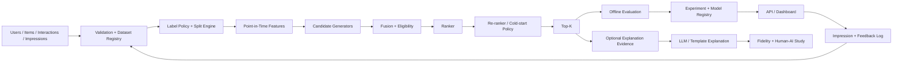

# RecomLab Architecture

## 1. Goal

RecomLab is a local-first, modular recommender platform. It intentionally separates **retrieval**, **ranking**, **re-ranking**, **evaluation**, and **human-facing explanation** so errors at one stage are not hidden by another.

## 2. High-Level Flow

## 3. Dataset Layer

Canonical entities:
- `User`
- `Item`
- `Interaction`
- `Impression`
- `FeedbackEvent`
- `DatasetManifest`

Raw data is immutable. Cleaning, labels, splits, and features are versioned derived artifacts.

## 4. Retrieval Layer

Candidate generators optimize recall under a candidate budget. Every candidate carries source provenance. Candidate fusion deduplicates and applies eligibility constraints before ranking.

## 5. Ranking Layer

Rankers score only eligible candidate items. Re-ranking may optimize diversity/calibration or apply cold-start policy, but must report relevance trade-offs.

## 6. Evaluation Layer

Evaluation has three explicit levels:
1. candidate recall,
2. ranking relevance conditional on candidates,
3. end-to-end recommendation/system quality.

Full-catalog evaluation is the preferred reference when feasible. Sampled evaluation is a diagnostic mode and is never silently mixed with full-catalog results.

## 7. Statistical Comparison

Model comparison includes uncertainty (e.g., user-level bootstrap intervals) and paired comparisons, not only point estimates.

## 8. Exposure-Aware Path

When impression logs and valid propensities exist, an optional off-policy evaluation module may estimate exposure-corrected outcomes. It must fail closed when required logging is absent.

## 9. Serving & Workflow

A model registry holds compatible retrieval/ranking bundles. The serving layer logs ranked impressions. Retraining creates a challenger; promotion happens only after predefined primary/guardrail criteria pass.

## 10. Human-AI Explanation Layer

Explanations consume a **grounding evidence payload** derived from the recommender. They never alter ranking. Fidelity and user perception are evaluated separately.

## 11. Persistence

- SQLite: run/model/study metadata
- Parquet: processed analytical datasets
- filesystem/object-like local artifact directory: models and reports
- no mandatory external vector database or feature store for v1

## 12. Invariants

1. No future/test leakage.
2. Retrieval and ranking remain separable.
3. Training negative sampling is not evaluation truth.
4. Evaluation protocol is recorded with every result.
5. Baselines are mandatory.
6. LLMs do not fabricate recommender evidence or metrics.
7. Real human-participant data is separate from demo/synthetic data.

## 13. Configuration

`recomlab.config.load_settings()` returns a frozen, validated `Settings` object
(environment, DB URL, paths, dataset, evaluation, optional LLM provider). Precedence:
defaults → optional TOML file → `RECOMLAB_*` environment variables → explicit overrides.
Invalid values and missing mandatory settings raise `ConfigError`. API keys are wrapped
in `SecretStr` and never appear in `repr`. `config/settings.py` is the only module that
reads environment variables (enforced by a test); all other code receives `Settings`.

## 14. Dependency Policy

- Mandatory runtime dependency: NumPy. Everything else is an optional extra.
- Heavy ANN engines (FAISS, hnswlib, ...), learning-to-rank libraries (LightGBM, XGBoost),
  deep-learning frameworks, and LLM SDKs require a task-level justification recorded in
  the task's verification evidence, must sit behind a project interface/adapter, and must
  never be required by mandatory CI tests.
- Every such adapter needs a pure-Python/NumPy reference implementation (e.g. exact
  brute-force retrieval) that the tests use.
- New dependencies are added to an optional extra in `pyproject.toml`, not to core.

## 15. Experiment Registry & Reproducibility

- `RunManifest` (`recomlab.experiments.manifest`, schema 1.0) stores dataset id/version/
  checksum, split id, feature version, label policy, model name/version/params, metric
  configuration, evaluation universe/mode, seeds, metrics, artifact paths, software state
  (Python, platform, package versions) and the optional git commit.
- `config_hash` covers only the configuration (not metrics or timestamps); `run_id` combines
  experiment id, config hash and creation time so repeated executions are distinct but
  traceable to the same configuration.
- `validate_manifest` rejects missing/unknown fields, wrong types, non-integer seeds,
  unsupported schema versions and tampered config hashes.
- `ExperimentRegistry` persists manifests in SQLite and supports `list_runs`,
  `find_by_config` and `compare_runs` without any notebook state.
- Seeds: `make_rng(seed, *names)` returns isolated NumPy generators (preferred);
  `set_global_seed` seeds Python/NumPy and PyTorch when it is installed.

## 16. Point-in-Time Features (`recomlab.features`, version `pit-1.0`)

`PointInTimeFeatures(events, items, as_of)` uses only events strictly before `as_of`.

| Group | Features |
|---|---|
| user | `history_length`, `distinct_items`, `days_since_last_event`, `days_active`, `mean_rating`, category profile |
| item | `popularity`, `unique_users`, `recent_popularity` (exponential decay, half-life param), `days_since_last_event`, `mean_rating`, categories |
| user-item | `category_affinity`, `seen_before` |

Undefined values (e.g. no history) are `None`, not zero. `strict=True` raises
`FutureDataError` if the input contains events at/after `as_of`; `assert_point_in_time`
verifies the built object. The `FeatureManifest` (version, `as_of`, events used, latest event
time used, params) is stored in `RunManifest.features`. Training-time aggregates are built
from the training partition only; validation/test events never contribute.

## 17. Retrieval Contract (`recomlab.candidates`)

- `CandidateRequest(user_id, budget, exclude_items, request_id)`: the budget is a mandatory
  positive integer. Requests carry no labels and no held-out data.
- `CandidateGenerator.fit(history, items, as_of)` fails closed when history contains events
  at/after `as_of`; `generate(request)` returns a `CandidateSet` from a single source with
  unique items, ranks `1..n`, source score, per-candidate evidence, source version, and
  metadata (`n_scored`, `n_after_exclusions`, `budget`, `truncated`, `latency_ms`).
- Ordering is deterministic: descending score, ties by ascending item id.
- `validate_candidate_set` enforces budget, uniqueness, rank sequence, single source, and
  exclusions. Duplicates across sources are expected and resolved only by fusion (§ 3.5).
- `generate_all` runs several generators for later fusion; generator names must be unique.
- `PopularityCandidates` (training-history counts) is the reference generator and the
  explicit cold-user fallback source.

### 17.1 Item-Item Generator (`candidates.item_item.ItemItemCandidates`)

- Similarity = `(1 - metadata_weight) * co-occurrence cosine + metadata_weight * category Jaccard`,
  built from training interactions and item metadata only; top `neighbors_per_item` kept.
- Candidates sum neighbor similarities of the user's last `history_window` unique items with
  recency weights `decay ** age_rank`; consumed items are skipped.
- Evidence per candidate: up to 3 seed items with their similarity.
- Users without history return an empty set with `metadata.fallback_required = True` and
  `reason = "cold_user_no_history"`; the caller must apply an explicit fallback source.

### 17.2 Collaborative Generator (`candidates.collaborative.CollaborativeCandidates`)

- Top-N items by ALS score `x_u · y_i` from an `ALSArtifact` trained on the visible history
  (`fit`) or injected (`from_artifact`); `source_version` is the artifact content version.
- `exclude_consumed=True` (default) removes items the user interacted with in that history.
- Unknown users return an empty set with `fallback_required = True` (`reason = "unknown_user"`).
- `generate_batch` scores all requested users with one matrix product; tests assert it
  matches per-user `generate` exactly in items and scores.
- Candidate recall is measured independently of ranking with
  `evaluation.retrieval.candidate_recall` / `candidate_hit`.

### 17.3 Embedding Retrieval (`candidates.embedding`)

- `EmbeddingProvider` exposes a versioned `EmbeddingTable` of item vectors and a user vector:
  `ALSEmbeddingProvider` (latent factors, version tied to the ALS artifact) and
  `CategoryEmbeddingProvider` (L2-normalized multi-hot categories; user = mean of history).
- `NearestNeighborIndex` implementations record `IndexMetadata` (type, embedding version,
  metric, size, dim). `ExactIndex` (brute force, cosine or dot, id tie-break) is the
  mandatory baseline. `HnswlibIndex` is an optional adapter that raises
  `OptionalDependencyError` when `hnswlib` is absent; no core test needs vector infrastructure.
- `EmbeddingCandidates` refuses an index whose embedding version differs from the provider
  (`IndexVersionMismatch`), excludes consumed items, and flags users without an embedding
  (`fallback_required`). Availability/eligibility is applied later during fusion.

### 17.4 Fusion & Eligibility (`candidates.fusion`)

- `FusionConfig(method="rrf" | "weighted_score", weights, rrf_k, budget)`; unspecified source
  weights default to 1.0. RRF adds `w / (rrf_k + rank)`; weighted score adds `w * minmax(score)`
  per source (constant-score source → 1.0).
- Items are deduplicated by id; `FusedCandidate.sources` keeps each contributing source's
  score, rank, contribution and evidence. Sources are processed in sorted order and output
  is sorted by `(-score, item_id)`, so fusion is deterministic and input-order independent.
- `EligibilityFilter` (availability, excluded catalog entries, consumed-item policy) runs
  after deduplication and can only remove items. `counts` records
  `pre_dedup`, `post_dedup`, `post_filter`, `final`; `removed` records
  `not_eligible_catalog` and `consumed`.

## 18. Ranking Contract (`recomlab.rankers`)

- `RankRequest(user_id, candidates, k, request_id)` holds one user's deduplicated candidate
  set (`RankCandidate`: item id, fused retrieval score, source provenance). It contains no
  labels; `RankRequest.from_fused` builds it from fusion output.
- `Ranker._score` returns `{item: (raw_score, contributions)}`. `Ranker.rank` rejects any
  scored item outside the candidate set (`RankerContractError`), applies `_finalize`
  (calibration hook, identity by default), orders by `(-final_score, item_id)`, truncates to
  `k`, and records `n_candidates`, `n_unscored`, and `latency_ms`.
- `RankedList` / `RankedItem` (raw score, final score, rank, per-feature contributions,
  model name/version) are JSON-serializable and contain no presentation or explanation text.
- `RetrievalScoreRanker` ranks by fused retrieval score and serves as the identity baseline.

### 18.1 Heuristic Ranker (`rankers.heuristic.HeuristicRanker`)

`score = Σ w_f · x_f` over normalized features: `retrieval` (min-max of fused retrieval
score within the request), `popularity` (`log1p(count)/log1p(max count)`), `recency`
(decayed popularity / catalog max), `content` (point-in-time category affinity).
Defaults: retrieval 0.4, popularity 0.2, recency 0.1, content 0.3. All statistics come from a
`PointInTimeFeatures` snapshot that must pass `assert_point_in_time`. Contributions
`w_f · x_f` sum exactly to the raw score and are returned per item for explanation
grounding. `params()` (weights + feature manifest) goes into the run manifest.

### 18.2 Collaborative Ranker (`rankers.collaborative.CollaborativeRanker`)

Scores fused candidates with the trained ALS model (only the candidate ids are passed to the
model). Unknown users fall back to training popularity for every candidate
(`metadata.fallback = "unknown_user"`); unknown items for known users are placed strictly
below all known items and ordered by popularity (`unknown_items:<n>`). Output metadata
records the ALS model version and latency; `rank_batch` serves offline evaluation.

## 19. Serving: Pipeline, Model Registry & Recommendation Service

- `services.pipeline.RecommendationPipeline(spec, history, items, as_of, artifacts_dir)`
  assembles retrieval generators (`popularity`, `item_item`, `collaborative`) → fusion +
  eligibility → ranker (`heuristic`, `collaborative`, `retrieval_score`) → cold-start
  policy from a declarative bundle spec. The same object serves online requests and
  offline checks.
- `registry.model_registry.ModelRegistry` stores immutable bundles
  (`bundles/<bundle_id>/bundle.json` + copied artifacts with sha256 checksums; the id is a
  content hash of spec, metadata and artifacts). `activate()` validates first — artifact
  checksums, ALS artifact version, catalog size, and a probe request through the full
  pipeline — and only then updates `active.json`; any failure raises
  `IncompatibleBundleError` and leaves the active bundle unchanged. `rollback()` reactivates
  the previous bundle and records the reason; the activation history is append-only.
- `services.recommendation.RecommendationService` serves the active bundle:
  `RecommendationRequest(user_id, k, trace_id)` → `RecommendationResponse` with trace id,
  bundle id, component versions, per-item rank/score, fused source provenance,
  ranker contributions (explanation grounding), and fallback labels. Swaps are atomic
  (the new pipeline is built and validated before it replaces the old one).

## 20. HTTP API (`recomlab.api`, optional extra `.[api]`)

| Method | Path | Notes |
|---|---|---|
| GET | `/health` | liveness + version |
| GET | `/ready` | 200 with active bundle id, 503 `not_ready` otherwise |
| POST | `/recommendations` | body `{user_id, k (1–100), trace_id?}`; returns ranked items, scores, source ranks, ranker contributions, fallback labels, bundle id, component versions |
| GET | `/experiments/runs?experiment_id=` | run summaries |
| GET | `/experiments/runs/{run_id}` | manifest without platform details |
| GET | `/models/bundles`, `/models/active` | registry state and activation history |
| POST | `/models/activate` | requires `X-Admin-Token` matching `RECOMLAB_API_ADMIN_TOKEN` (constant-time compare); disabled (403) when no token is configured; incompatible bundles → 409 |

Errors use one structured shape: `{"error": {"code", "message", "details?"}}` (validation
errors list `field` and `issue`). Controllers only call services/registries. Responses
never include secrets, raw interaction histories, or candidate evidence (which can contain
the user's own history). `uvicorn recomlab.api.main:app` builds the app from `Settings`.

## 21. Dashboard (`recomlab.dashboard`, optional extra `.[dashboard]`)

`streamlit run src/recomlab/dashboard/app.py` renders four pages from view models in
`dashboard.views`: experiment leaderboard, run details (identity, protocol and warnings,
candidate-stage vs ranking-stage metrics), recommendation explorer over pseudonymous demo
ids (scores, sources, fallback, top contributions), and cold-start / beyond-accuracy views.
Views read only the experiment registry and the recommendation service built by
`services.bootstrap`; they never train models or compute metrics, and they never display
user attributes or raw histories.
